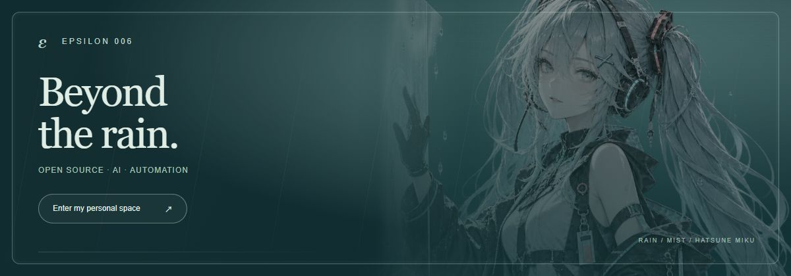

  <a href="https://epsilon006.github.io/"><strong>Enter my personal space ↗</strong></a>
  &nbsp; · &nbsp;
  <a href="https://github.com/Epsilon006?tab=repositories">Browse repositories</a>

---

## Hi, I'm Alpinist

Curious about how things work — and how to make them a little better.

### Currently exploring

- **AI agents** — tools, memory, and the systems that connect them.
- **Python & developer tools** — small experiments, clearer code, and useful workflows.
- **Interactive experiences** — the meeting point of technology, atmosphere, and design.

### My approach

Read the source. Ask questions. Try small things. Keep learning.

---

  <em>A quiet corner for curiosity, experiments, and things still taking shape.</em>

